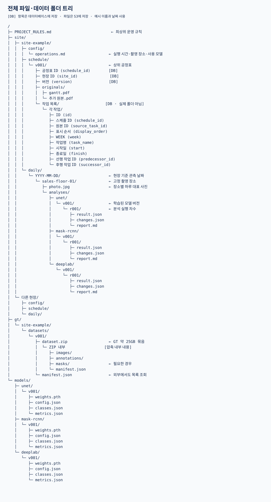
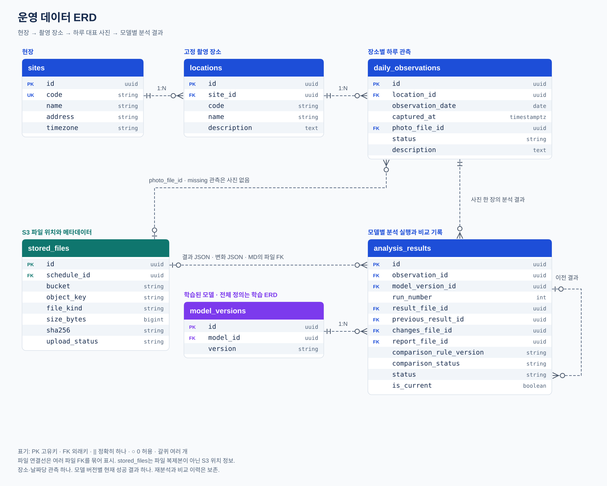
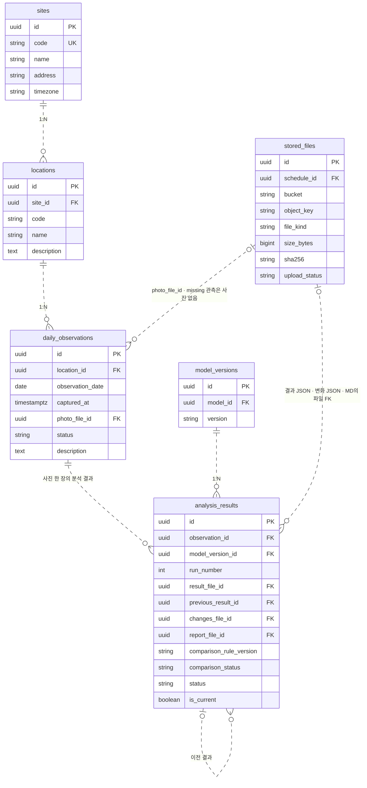
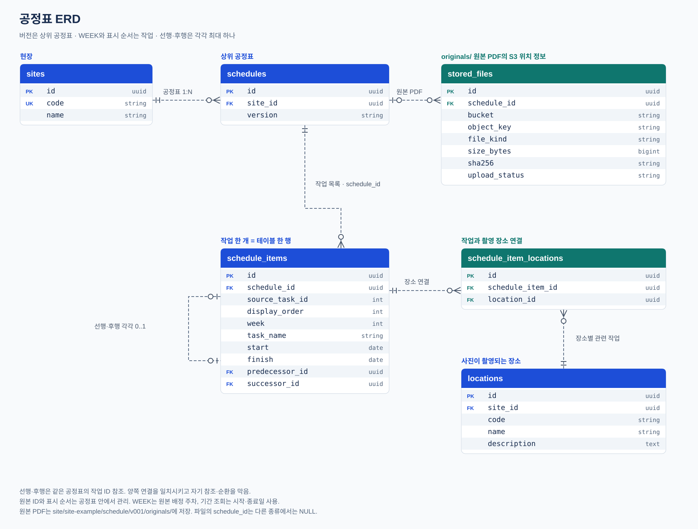
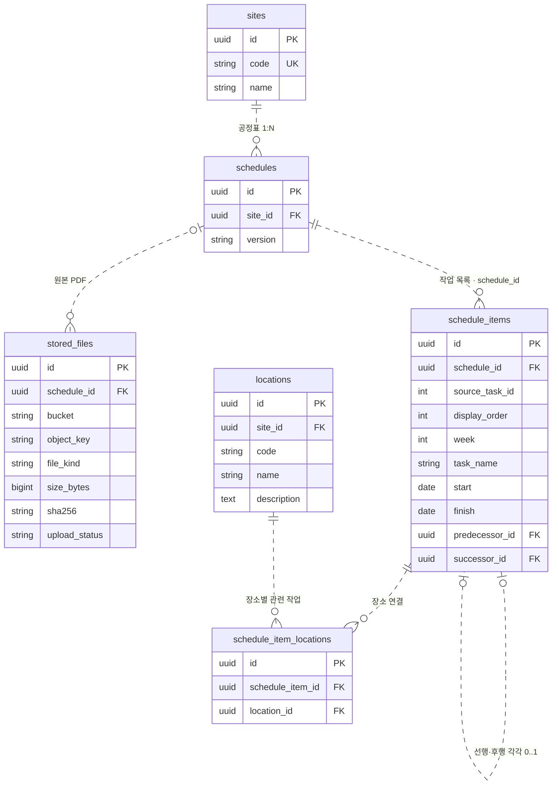
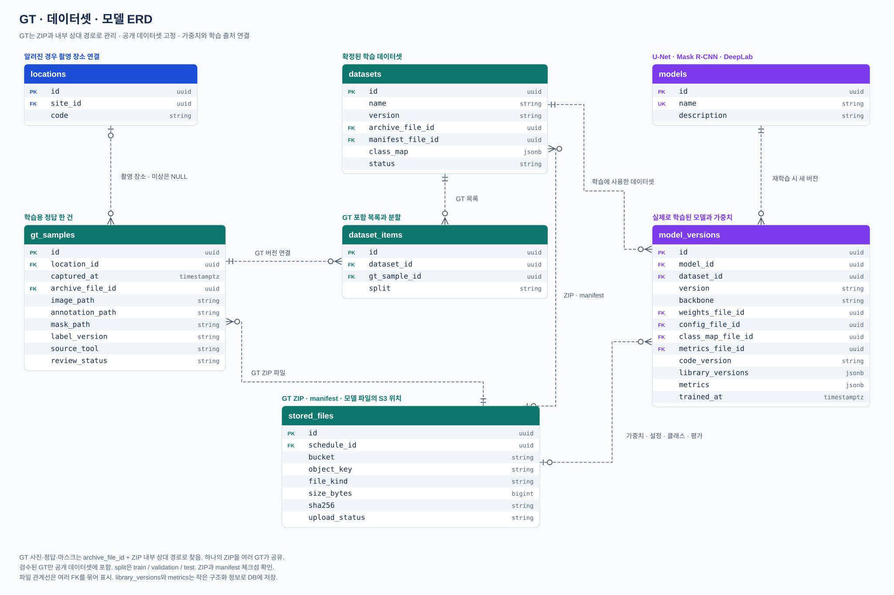
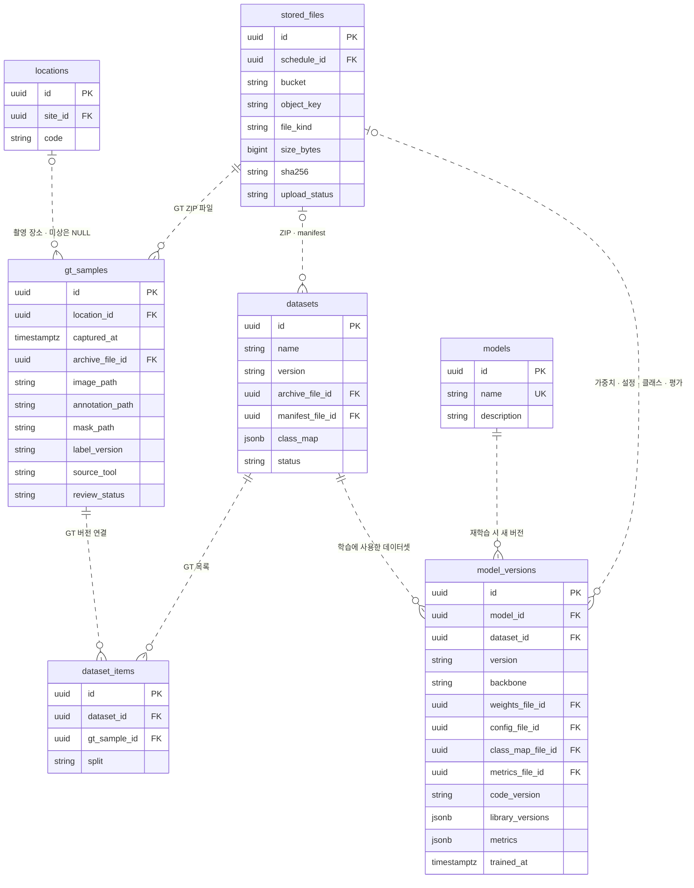

# 폴더 트리와 ERD 참고도

## 먼저 확인할 점

이 폴더의 그림은 **이전 설계 참고도**다. 현재 운영 SQL과 테이블 이름·저장 방식이 다르며, 그림만 보고 현재 DB를 새로 만들지 않는다.

현재 구현 기준은 [백엔드 설명](../public/BACKEND.md)과 [PostgreSQL 초기 SQL](../../src/backend/sql/001_initial.sql)이다. 실제 운영 DB에는 SQL이 이미 적용돼 있다. 파일 저장소는 현재 Lightsail이며 S3를 사용하지 않는다.

현장 이름과 날짜는 범용 예시로 바꿨고, 접속 주소·계정·키·실데이터 링크는 포함하지 않았다. SVG를 누르면 원본을 크게 볼 수 있다. 아래 Mermaid와 [폴더 트리 텍스트](directory-tree.md)는 그림 미리보기가 안 보여도 읽을 수 있다.

## 현재 구현과의 차이

| 이전 그림 | 현재 SQL·구현 |
|---|---|
| S3 bucket/object_key, stored_files | Lightsail 상대 경로, files |
| daily_observations + analysis_results | daily_records에 대표 사진·결과·직전 관측 연결 |
| 모델별 여러 분석 실행·r001 이력 | 현재 일일 대표 결과 한 건; 재분석 이력 API 미구현 |
| schedule_items | schedule_tasks |
| 공정표 원본을 stored_files.schedule_id로 연결 | schedule_sources로 공정표 버전과 원본 파일 연결 |
| schedule_item_locations | schedule_task_locations |
| gt_samples / datasets / dataset_items | gt_datasets; ZIP 내부 자료·분할은 manifest에서 관리 |
| models + model_versions | model_versions의 model_type·버전·파일 참조 |

## 전체 폴더 트리

[텍스트 트리](directory-tree.md) · [SVG 원본](directory-tree.svg)

## 운영 데이터 ERD

[SVG 원본](erd-operations.svg) · [Mermaid 원문](erd-operations.mmd)

### GitHub에서 읽는 Mermaid 참고도

## 공정표 ERD

[SVG 원본](erd-schedule.svg) · [Mermaid 원문](erd-schedule.mmd)

### GitHub에서 읽는 Mermaid 참고도

## GT·모델 ERD

[SVG 원본](erd-training-models.svg) · [Mermaid 원문](erd-training-models.mmd)

### GitHub에서 읽는 Mermaid 참고도

