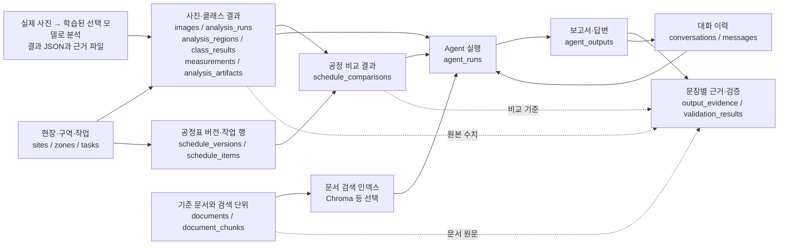
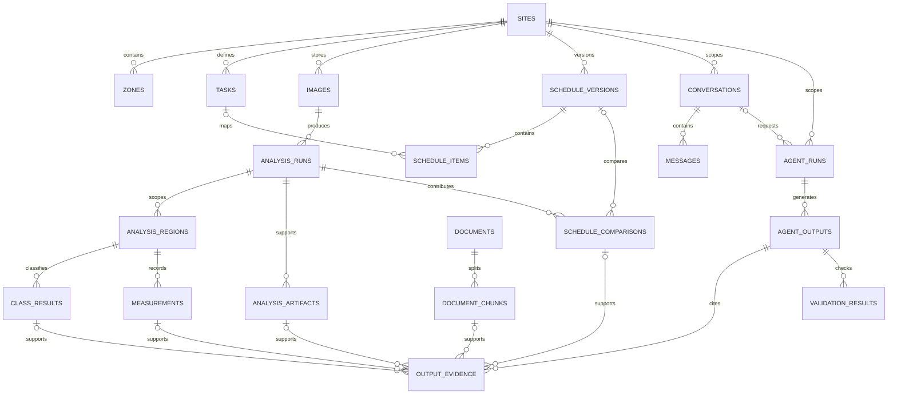

# 서버 DB와 Agent의 전체 구조

> 이전 기획안이다. 현재 Lightsail DB 구축에는 [최종 구조 및 결정 기록](lightsail-db-final.md)을 사용한다. Agent 기능은 현재 구축 범위 밖이다.

작성일: 2026-10-05 · 갱신일: 2026-10-11 · 검토용 제안 · 테이블의 세부 타입과 API 계약은 후속 설계

A안의 비전 분석 결과 JSON을 서버가 받고, 공정표·문서 근거를 조회한 Agent가 보고서와 답변을 만드는 구조다. 여러 현장 지원은 설계 제안이며 실제 분석 대상은 보류 중이다. 상태별 클래스를 분리하지만 목록·측정 기준은 미정이다. 전처리·학습·성능 비교는 별도 작업 컴퓨터에서 수행한다. LoMa-L/RoMa v2 매칭, 별도 기하 정합·검증과 자체 JSON 생성의 실행 위치·세부 계약은 후속 결정한다.

## 1. 큰 흐름

학습은 **SAM3 초안 → 사람 검수·GT 확정 → 원본 사진 + GT로 ResNet-50 기반 DeepLabv3+·U-Net·Mask R-CNN 학습·비교 → 운영 모델 선택**으로 진행한다. SAM3는 Grounding DINO + SAM 2.1과 비교한 뒤 채택했다.

아래 서버 흐름의 입력은 **실제 현장 사진을 학습된 선택 모델로 처리한 결과 JSON과 근거**다. 서버가 결과를 검증·저장·조회한 뒤 Agent가 이를 보고서·질의응답에 활용한다. GT 제작·학습 메타데이터는 별도 학습 관리 범위다.

Agent는 DB 조회 API와 문서 검색 도구로 근거를 얻는다. 수치 계산과 공정 판정 규칙은 백엔드에서 처리하고, Agent가 생성한 설명은 원본 수치·날짜·근거와 대조한다. 검증을 통과한 출력과 검토가 필요한 출력을 상태값으로 구분한다.

## 2. 테이블별로 들어가는 데이터

아래 ID는 각 행의 식별자이고, 연결 ID는 참조하는 테이블의 행을 가리킨다. 공통 생성·수정 시각과 세부 인덱스는 생략했다.

### 현장과 작업 기준 정보

| 테이블 | 주요 데이터 | 사용 목적 |
| --- | --- | --- |
| sites | site_id, 현장 코드·이름, 위치, 시간대, 운영 상태 | 여러 현장 구분 |
| zones | zone_id, site_id, 상위 구역 ID, 층·구역 코드·이름 | 사진과 작업의 위치 식별 |
| tasks | task_id, site_id, 작업 코드·이름, 공종, 수량 단위 | 분석과 공정표가 참조할 안정된 작업 ID |

테스트용 예: 가상 현장 → 가상 구역 → 가상 작업. 실제 분석 대상은 아직 정하지 않았다. 구역·작업 코드는 현장 안에서 유일하게 관리한다. 작업 하나가 여러 구역에 걸치면 작업과 구역의 상세 매핑을 후속 설계한다.

### 사진과 전달받은 비전 결과

| 테이블 | 주요 데이터 | 사용 목적 |
| --- | --- | --- |
| images | image_id, site_id, zone_id, 촬영 시각, 원본 파일 키, 해상도, 체크섬 | 사진의 촬영 맥락과 원본 추적 |
| analysis_runs | analysis_id, site_id, image_id, task_id, 원본 JSON, 스키마·라벨 버전과 정의 스냅샷, 모델명·버전, 출력 유형, 품질·측정 상태와 사유, 처리·수신 시각, 입력 해시 | 외부 분석 결과 한 건의 출처·버전 보존 |
| analysis_regions | region_id, analysis_id, ROI 좌표·좌표 기준, ROI 버전 | 사진의 어느 영역을 측정했는지 표시 |
| class_results | class_result_id, region_id, class_id, 출력 단위에 맞는 픽셀·인스턴스 개수, 결과 파일 참조 | 상태별 클래스 결과 보존. 클래스명은 확정 후 적용 |
| measurements | measurement_id, region_id, 지표명·규칙 버전과 정의 스냅샷, 값·단위·계산 상태·사유 | 기준 확정 후 계산한 지표만 저장 |
| analysis_artifacts | artifact_id, analysis_id, region_id, 마스크·오버레이·ROI 미리보기 유형, 파일 키·체크섬 | 수치와 함께 제시할 이미지 근거 |

원본 JSON은 전달받은 내용을 보존하고, 자주 조회하는 식별자·날짜·수치는 별도 컬럼으로 추출한다. 같은 분석 ID에 다른 입력이 들어오면 덮어쓰지 않고 충돌로 처리한다. 재분석은 새 analysis_id로 기록한다.

측정 기준이 미정이면 class_results와 근거부터 보존하고 measurements는 비워 둔다. Agent에도 측정 기준 미정 상태를 전달한다. 픽셀 분할과 인스턴스 분할의 집계 기준은 실제 출력 계약에서 결정한다.

첫 단계는 분석 실행 하나가 작업 하나를 가리키는 구조다. 한 사진의 ROI별 작업이 서로 다르면 실행을 작업별로 나누거나 region 단위 task 연결로 확장한다.

두 시점의 사진 비교 결과가 전달되는 경우 아래 테이블을 추가한다.

| 선택 테이블 | 주요 데이터 | 사용 목적 |
| --- | --- | --- |
| image_comparisons | image_comparison_id, site_id, 전·후 image_id와 분석 ID, 비교 모듈·버전, 정합 품질, 공통 영역, 변화량·산식 버전, 근거 파일, 비교 불가 사유 | 단일 사진 결과와 전후 비교 결과를 각각 보존 |

LoMa-L/RoMa v2의 대응점, 별도 기하 변환과 정합 검증 결과를 구분해 보존한다. 같은 대상인지 확인하고 정합을 통과한 공통 영역만 비교한다. 세부 필드는 출력 계약에서 정하며, 전체 공정률 변화로 환산하려면 별도 규칙이 필요하다.

### 공정표와 비교 결과

| 테이블 | 주요 데이터 | 사용 목적 |
| --- | --- | --- |
| schedule_versions | schedule_version_id, site_id, 버전 번호, 적용일, 원본 파일 참조·체크섬, 활성 상태 | 공정표 변경 전후 기준 보존 |
| schedule_items | schedule_item_id, schedule_version_id, site_id, task_id, 원본 작업 코드·이름, 계획 시작·종료일, 계획 물량·단위 | 해당 버전의 작업별 계획 |
| schedule_comparisons | comparison_id, site_id, analysis_id·region_id, task_id, schedule_version_id·schedule_item_id, 기준일, 비교 규칙 버전, 비교 가능 여부, 계획·환산 관측값·차이, 판정·불가 사유 | Agent가 설명할 비교 결과의 근거 |

공정 비교는 백엔드에서 계산한다. 계획 진척률 산출법과 관측값의 공정률 환산 기준이 합의된 경우에만 해당 값과 차이를 채운다. 날짜만으로 계획률을 임의로 선형 계산하거나 여러 사진 비율을 평균 내 전체 공정률로 사용하지 않는다. 기준이 없으면 사용 가능한 클래스 결과·근거와 계획 일정만 제공하고 비교 불가 사유를 기록한다.

### Agent가 검색할 문서

| 테이블 | 주요 데이터 | 사용 목적 |
| --- | --- | --- |
| documents | document_id, 현장 ID 또는 공통 문서 표시, 문서 묶음 ID, 제목·유형·버전, 적용 기간, 원본 파일 키·체크섬 | 시공 기준서·검수 지침·회의록·설명 문서의 원본과 버전 |
| document_chunks | chunk_id, document_id, 청크 순번, 본문, 페이지·절·표 위치, 내용 해시, 검색 인덱스 참조 | 검색 결과를 원문 위치와 연결 |

documents의 각 행은 문서 버전 하나를 나타낸다. 문서가 바뀌면 새 document_id를 만들고 기존 보고서가 인용한 청크를 보존한다. 현장 전용 문서는 해당 site_id로 제한하고, 공통 기준 문서는 적용 범위를 확인해 함께 조회한다.

문서 임베딩은 기존 기획의 Chroma 같은 검색 인덱스에서 관리할 수 있다. 인덱스 메타데이터에는 chunk_id·document_id·site_id·버전을 연결한다. PostgreSQL의 문서·청크를 기준으로 인덱스를 다시 만들 수 있도록 한다. 벡터 검색 결과가 숫자 계산의 원본을 대체하지 않는다.

### Agent 실행, 대화, 출력과 검증

| 테이블 | 주요 데이터 | 사용 목적 |
| --- | --- | --- |
| conversations | conversation_id, site_id, 대화 제목, 시작 시각 | 현장별 대화 묶음 |
| messages | message_id, conversation_id, 발화 역할, 질문 본문 또는 output_id, 발화 시각 | 사용자 질문과 답변 이력 |
| agent_runs | agent_run_id, site_id, conversation_id·요청 message_id, 실행 유형(report/qa), 질문·보고서 범위, 기준일, 사용한 데이터 ID·버전 목록, LLM·Agent·프롬프트 버전, 실행 상태 | 한 번의 Agent 실행 조건과 입력 추적 |
| agent_outputs | output_id, agent_run_id, 출력 유형(report/answer), 보고서·답변 본문, 구조화한 주장 목록, 버전, 검증 상태, 생성 시각 | 생성된 보고서·답변 저장 |
| output_evidence | evidence_id, output_id, 문장·주장 식별자, 근거 유형, 원본 데이터 참조, 사용한 값·버전 스냅샷 | 어느 문장이 어떤 분석·공정 비교·문서에서 나왔는지 연결 |
| validation_results | validation_id, output_id, 문장·주장 식별자, 검사 유형(수치/날짜/근거/현장 범위), 통과·불일치·근거 부족, 기대값·출력값, 사유 | 확정 가능한 설명과 검토 대상 구분 |

정기 보고서는 conversation_id 없이 agent_run을 만들 수 있다. 대화에서 생성한 답변은 messages가 output_id를 참조하도록 해 본문을 두 곳에서 각각 수정하지 않는다.

output_evidence의 원본 참조는 class_result_id, measurement_id, comparison_id, chunk_id, artifact_id 또는 선택적인 image_comparison_id 중 실제 근거 유형에 맞는 FK로 구현한다. 하나의 근거 행은 원본 한 개를 가리키고, 한 주장에 여러 근거 행을 붙일 수 있다. DB에서 유효성을 확인할 수 없는 임의의 source_id 문자열만 저장하는 구조는 피한다.

Agent 실행에 현장과 기준일을 고정하고, 선택한 분석·공정표·문서 버전을 입력 스냅샷으로 남긴다. 새 공정표나 새 분석 결과가 들어와도 과거 답변의 근거를 다시 찾을 수 있다. 불일치나 근거 부족은 agent_outputs의 needs_review 상태로 연결한다.

실행 중 도구 호출 상세 로그나 사람의 승인 이력이 필요해지면 agent_steps·review_events를 추가한다.

## 3. 관계를 큼직하게 보면

OUTPUT_EVIDENCE와 각 원본 테이블의 연결은 근거 유형별 선택 참조다. 실제 근거 행에서는 원본 FK 중 하나를 선택하며, 같은 문장에 필요한 만큼 행을 추가한다.

## 4. 한 질문이 처리되는 예

가상 질문: “이 구역의 해당 작업이 계획보다 늦나요?”

1. conversation과 agent_run에 해당 현장 및 질문 기준일을 고정한다.
2. 해당 현장·구역·작업의 사용 가능한 analysis와 class_results를 조회한다. 측정 기준이 정의된 경우에만 measurements도 조회한다.
3. 해당 기준일에 적용할 공정표 버전과 비교 결과를 조회한다. 비교 산식이 없으면 그 사유를 함께 가져온다.
4. 해당 현장 문서와 적용 가능한 공통 문서에서 기준 설명을 검색한다.
5. Agent가 답변을 생성하고, 수치·판단별 원본 근거를 output_evidence에 연결한다.
6. 수치·날짜·현장·인용 검증을 validation_results에 기록하고 output을 verified 또는 needs_review 상태로 저장한다.

비교 기준이 없으면 “사진 분석 결과와 근거는 확인되지만, 측정·비교 기준이 정해지지 않아 일정 지연 여부를 판단하기 어렵다”는 답변을 만든다. 관측값을 실제 공정률로 임의 변환하지 않는다.

## 5. 저장 책임과 후속 설계

PostgreSQL에는 식별자, 메타데이터, 검증한 수치, 문서 청크, Agent 출력과 출처를 저장한다. 사진·마스크·원본 문서·보고서 내보내기 파일은 서버에서 접근 가능한 파일 저장 계층에 둔다. 문서 검색 인덱스는 청크 식별자를 기준으로 연결한다.

현장 소속 데이터는 site_id와 복합 FK 등으로 같은 현장의 구역·작업·사진만 연결되게 한다. Agent의 조회 또한 해당 site_id와 기준일로 제한한다. 비교값과 문서의 버전을 바꾸지 않고 새 행으로 보존한다.

후속 설계에서 사용자·현장 권한, 공정표 입력 형식, 비전 JSON 예제, 보고서 템플릿, 문서 검색 인덱스 선택을 구체화한다. 서버의 기본 테이블에 대한 타입·제약 초안과 선택적인 학습 관리 구조는 [기존 상세 초안](database-schema.md)에 있다.
