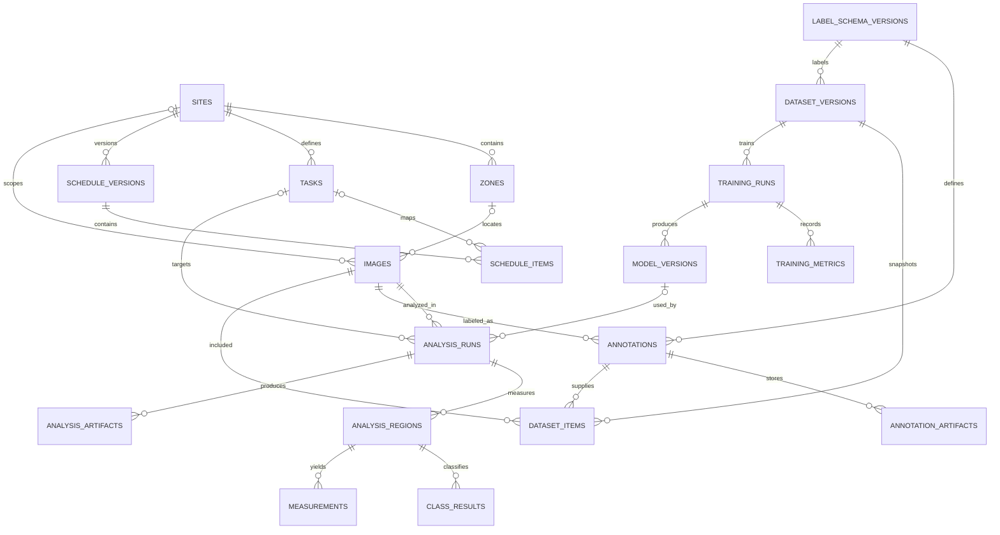

# DB 구조 설계 초안

작성일: 2026-10-05 · 갱신일: 2026-10-11 · 상태: 팀 검토용 제안

이 문서는 A안의 사진 관측 결과를 관리하는 서버 PostgreSQL DB 구조 초안이다. 분석 대상·클래스 정의·측정 기준은 미정이며, 여러 현장을 지원하는 구조도 제안 범위다. 전처리·학습·성능 비교는 별도 작업 컴퓨터에서 수행한다. 학습 관리 테이블은 선택적인 설계 참고안으로 보존하며, 서버 DB에 함께 둘지 별도 DB나 파일로 관리할지는 미정이다. 구현된 스키마나 팀 확정 사항은 아니다.

서버에서 Agent의 보고서·답변·근거·검증까지 이어지는 큰 흐름과 테이블별 데이터는 [서버 DB와 Agent 전체 구조](database-overview.md)에 정리했다. 아래 문서는 기존 컬럼·타입 초안이며, Agent 확장 테이블의 상세 타입은 후속 설계한다.

## 1. 설계 기준

- 공사 현장, 구역, 작업을 안정된 ID로 연결한다.
- 여러 현장 데이터는 site_id로 범위를 나누며, 모든 현장별 코드와 조회는 site 범위에서 유일·분리되게 한다.
- 공정표는 업로드된 원본 버전을 보존한다. 새 공정표를 가져와도 이전 분석 결과의 해석 조건을 덮어쓰지 않는다.
- 이미지 파일은 객체 저장소나 로컬 파일 계층에 두고, DB에는 위치 키와 체크섬 등 메타데이터를 둔다.
- 같은 사진을 다시 분석하면 새 분석 실행으로 남긴다. 과거 실행의 모델·측정 결과는 수정하지 않는다.
- 파이프라인 실행 상태와 측정 품질 상태를 별도 필드로 관리한다.
- 클래스별 결과와 정의 버전을 함께 저장하고, 상태별 클래스를 분리한다. 구체적 클래스명은 추후 확정한다.
- 클래스 결과와 파생 측정값은 분리한다. 측정 단위·산식·유효 범위·계산 불가 처리 기준은 아직 미정이다.
- 합의된 물량·가중치·환산 규칙이 생기기 전에는 사진 관측값을 실제 공정률로 저장하거나 표시하지 않는다.

### 작업 실행 위치와 저장 범위

Grounding DINO + SAM 2.1과 SAM3를 비교한 뒤 라벨 제작에는 SAM3를 채택했다. SAM3 초안을 사람이 검수·수정해 GT로 확정하고, 원본 사진과 GT로 ResNet-50 기반 DeepLabv3+·Mask R-CNN·U-Net을 학습·비교한다. 이 학습 작업은 별도 작업 컴퓨터에서 수행하며, 운영 모델 선택까지 프로젝트 범위다.

운영 시 실제 사진을 학습한 선택 모델로 처리한 후, 자체 후처리 코드가 결과 JSON·근거 참조를 생성해 서버로 전달한다. 서버 DB는 결과를 검증·저장·조회하고 Agent는 이 분석 결과와 공정표·문서 근거를 바탕으로 보고서를 작성한다.

후속 LoMa-L 또는 RoMa v2는 전후 사진의 대응점을 찾고, 별도 기하 정합·검증을 통과한 공통 영역의 상태 마스크를 비교한다. JSON은 분할·매칭 결과를 자체 후처리 코드가 정리해 생성한다. 이 단계의 실행 위치와 세부 출력 계약은 미정이다. 서버 DB는 전달받은 분석 JSON과 사진·근거의 참조를 검증·저장하고, 공정표 조회와 Agent의 근거 조회를 지원한다.

실행 위치와 결과 저장 위치는 별개의 결정이다. 작업 컴퓨터에서 생성된 학습 메타데이터를 서버 DB로 전달할 수는 있지만, 이를 필수 운영 범위로 확정하지 않는다.

## 2. 엔터티와 관계

| 엔터티 | 역할 | 관계 |
| --- | --- | --- |
| sites | 현장 기본 정보 | 구역, 작업, 공정표 버전, 사진을 소유 |
| zones | 현장 내 층·구역·촬영 위치 | 현장 소속이며 상위 구역을 둘 수 있음 |
| tasks | 공종 또는 추적 대상 작업의 안정된 기준 ID | 현장 소속, 분석 결과와 공정표 항목의 연결점 |
| schedule_versions | 업로드된 공정표의 불변 버전 메타데이터 | 현장별 여러 버전 |
| schedule_items | 특정 공정표 버전의 작업 행과 계획값 | 버전 소속, 기준 작업과 선택적으로 매핑 |
| images | 원본 사진 위치 및 촬영 메타데이터 | 현장·선택적 구역 소속, 여러 분석 실행을 가짐 |
| analysis_runs | 한 사진에 대한 한 번의 분석 요청·실행·결과 상태 | 사진과 선택적 작업 연결 |
| analysis_regions | 실행에서 측정한 ROI와 좌표 정보 | 분석 실행당 0개 이상 |
| class_results | ROI별 클래스 결과와 출력 단위 | 분석 영역당 클래스별 여러 행 |
| measurements | 정의된 규칙으로 계산한 파생 측정값 | 분석 영역당 지표별 여러 행. 기준 미정이면 행을 생성하지 않음 |
| analysis_artifacts | 마스크, 오버레이 등 분석 산출물의 파일 참조 | 분석 실행에 종속 |
| label_schema_versions | 학습·검수에서 사용할 클래스 이름과 정의의 버전 | annotation과 dataset에 연결 |
| annotations | 이미지에 대한 사람 검수·확정 라벨 버전 | 이미지와 라벨 스키마 연결 |
| annotation_artifacts | 분할 정답 마스크와 라벨 미리보기 파일 참조 | annotation에 종속 |
| dataset_versions | 학습에 사용한 불변 데이터셋 스냅샷 | 이미지·annotation·split을 포함 |
| dataset_items | 데이터셋 버전 내 이미지·annotation과 train/validation/test 분할 | dataset, image, annotation 연결 |
| training_runs | 한 데이터셋으로 수행한 학습 실험 설정과 상태 | dataset 버전에서 여러 학습 실행 |
| training_metrics | 학습 실행별 epoch·split·클래스 지표 | training run에 종속 |
| model_versions | 배포·추론 가능한 가중치 버전과 저장 위치 | 학습 실행 산출물, 추론 실행에서 참조 |

아래는 서버 운영 테이블과 선택적인 학습 관리 테이블을 함께 표시한 논리 관계다. 학습 관리가 별도 DB에 있으면 DB 간 FK를 만들지 않고 전달받은 식별자·모델명·버전으로 추적한다.

- sites 1:N zones, tasks, schedule_versions, images
- schedule_versions 1:N schedule_items
- images 1:N analysis_runs
- analysis_runs 1:N analysis_regions, analysis_artifacts (실패 실행은 영역이 없을 수 있음)
- analysis_regions 1:N class_results, measurements (측정 기준 미정이면 measurements는 0행)
- schedule_items N:1 tasks (작업 매핑이 확인된 경우)
- label_schema_versions 1:N annotations, dataset_versions
- dataset_versions 1:N dataset_items, training_runs
- training_runs 1:N training_metrics, model_versions
- model_versions 0..1:N analysis_runs (사용 모델을 등록한 경우)

## 3. 테이블 제안

### sites

| 컬럼 | 타입 제안 | 규칙·의미 |
| --- | --- | --- |
| site_id | UUID | PK |
| site_code | VARCHAR(80) | 현장 코드, UNIQUE |
| name | VARCHAR(200) | 현장명 |
| timezone | VARCHAR(64) | 기본 Asia/Seoul |
| status | VARCHAR(20) | active / archived CHECK |
| created_at, updated_at | TIMESTAMPTZ | UTC 기준 시각 |

### zones

| 컬럼 | 타입 제안 | 규칙·의미 |
| --- | --- | --- |
| zone_id | UUID | PK |
| site_id | UUID | sites FK |
| parent_zone_id | UUID NULL | 같은 현장 내 상위 구역, 선택 사항 |
| zone_code | VARCHAR(80) | 현장 안에서 UNIQUE |
| name | VARCHAR(200) | 구역명 |
| created_at | TIMESTAMPTZ | 생성 시각 |

권장 제약은 UNIQUE(site_id, zone_code)와 UNIQUE(site_id, zone_id)이며, parent_zone_id가 같은 site_id 안의 구역만 가리키도록 복합 FK를 둔다. images의 zone_id도 site_id와 함께 복합 FK로 묶어 다른 현장의 구역이 연결되지 않게 한다.

### tasks

| 컬럼 | 타입 제안 | 규칙·의미 |
| --- | --- | --- |
| task_id | UUID | PK |
| site_id | UUID | sites FK |
| task_code | VARCHAR(100) | 현장 안에서 UNIQUE인 안정된 작업 코드 |
| name | VARCHAR(250) | 작업명 |
| unit | VARCHAR(40) NULL | 수량 단위. 단위 정의 전에는 NULL 허용 |
| status | VARCHAR(20) | active / archived CHECK |
| created_at, updated_at | TIMESTAMPTZ | 생성·수정 시각 |

UNIQUE(site_id, task_code)와 복합 FK용 UNIQUE(site_id, task_id)를 둔다. 작업의 일정별 계획값은 tasks에 넣지 않고 schedule_items에 둔다. 그래야 공정표 버전마다 달라진 계획을 보존할 수 있다.

### schedule_versions

| 컬럼 | 타입 제안 | 규칙·의미 |
| --- | --- | --- |
| schedule_version_id | UUID | PK |
| site_id | UUID | sites FK |
| version_no | INTEGER | 현장별 증가 번호, 1부터 시작 |
| source_name | VARCHAR(255) NULL | 원본 파일명 또는 가져온 자료 식별자 |
| source_sha256 | CHAR(64) NULL | 같은 파일 식별·중복 확인용 |
| effective_from | DATE NULL | 팀이 정한 적용일. 없으면 NULL |
| imported_at | TIMESTAMPTZ | 가져온 시각 |
| status | VARCHAR(20) | draft / active / superseded CHECK |

UNIQUE(site_id, version_no)와 복합 FK용 UNIQUE(site_id, schedule_version_id)를 둔다. 활성 버전은 현장당 최대 하나로 관리하되, 데이터베이스 부분 유니크 인덱스 또는 트랜잭션 처리 방식을 구현 시 선택한다. 원본 공정표 파일 자체를 DB에 넣지 않는다.

### schedule_items

| 컬럼 | 타입 제안 | 규칙·의미 |
| --- | --- | --- |
| schedule_item_id | UUID | PK |
| site_id | UUID | sites FK, 현장 범위 |
| schedule_version_id | UUID | schedule_versions FK |
| task_id | UUID NULL | tasks FK. 코드 매핑 검토 전에는 NULL |
| external_task_code | VARCHAR(120) | 원본 공정표의 작업 식별자 |
| task_name_snapshot | VARCHAR(250) | 해당 버전 파일에 기록된 작업명 |
| planned_start, planned_finish | DATE NULL | 해당 버전의 계획 기간 |
| planned_quantity | NUMERIC(14,3) NULL | 물량 컬럼을 확인한 뒤 사용 |
| unit_snapshot | VARCHAR(40) NULL | 원본 행의 단위 |

UNIQUE(schedule_version_id, external_task_code)를 둔다. schedule_versions와 tasks에 UNIQUE(site_id, schedule_version_id), UNIQUE(site_id, task_id)를 둬서 schedule_items의 site_id와 함께 복합 FK를 구성하고 다른 현장 데이터의 연결을 막는다. 날짜 역전, 음수 수량은 CHECK로 거부한다. 가중치나 계획 진척률 필드는 산식·의미가 합의되기 전에는 추가하지 않는다.

### images

| 컬럼 | 타입 제안 | 규칙·의미 |
| --- | --- | --- |
| image_id | UUID | PK |
| site_id | UUID NULL | sites FK. 물리 현장에 속하지 않는 학습 전용 이미지는 NULL 허용 |
| zone_id | UUID NULL | zones FK. site_id와 일치하는 구역만 허용 |
| object_key | TEXT | 원본 이미지의 저장 계층 키 |
| sha256 | CHAR(64) | 내용 무결성·중복 확인용 |
| source_type | VARCHAR(30) | site_capture / synthetic / public_dataset / external |
| source_reference | TEXT NULL | 출처·라이선스·사용 허가를 식별할 참조 |
| training_eligibility | VARCHAR(20) | pending / approved / rejected CHECK |
| capture_group_key | VARCHAR(160) NULL | 연속·유사 촬영본의 데이터 분할 누수 방지용 그룹 |
| content_type | VARCHAR(100) | 허용 이미지 형식 확인용 |
| byte_size | BIGINT | 0 이상 |
| width_px, height_px | INTEGER NULL | 픽셀 크기 |
| captured_at | TIMESTAMPTZ NULL | 사진 촬영 시각. 업로드 시각과 구분 |
| uploaded_at | TIMESTAMPTZ | 수신 시각 |
| metadata | JSONB | 선택 메타데이터. 조회 핵심 필드는 별도 컬럼 유지 |

이미지 URL 대신 만료되지 않는 저장 키만 기록하고, 접근 URL은 서비스에서 권한 확인 후 만든다. 물리 현장 분석 요청은 site_id가 있는 이미지만 허용하고, site_id가 NULL인 합성·외부 학습 이미지는 추론 대상에서 제외한다. 구역 FK는 (site_id, zone_id) 복합 FK로 같은 현장 소속을 강제한다. 원본 경로나 EXIF 등 민감할 수 있는 값은 저장 필요성을 먼저 검토한다.

복합 FK 지원을 위해 UNIQUE(site_id, image_id)를 둔다. site_id가 NULL인 학습 이미지는 annotation·dataset에는 넣을 수 있지만 analysis_runs에서는 사용할 수 없다. source_type과 training_eligibility 값에는 CHECK를 둔다.

### analysis_runs

분석 실행의 결과와 수신 이력을 연결하는 테이블이다. 실행 기록을 저장한다는 사실이 서버에서 모델을 실행한다는 뜻은 아니다.

| 컬럼 | 타입 제안 | 규칙·의미 |
| --- | --- | --- |
| analysis_id | UUID | PK이자 API 계약의 안정된 분석 ID |
| site_id | UUID | sites FK, 현장 단위 조회·권한 검사의 기준 |
| image_id | UUID | images FK |
| task_id | UUID NULL | tasks FK. 작업 식별이 확인된 경우 |
| model_version_id | UUID NULL | 같은 DB에 모델 레지스트리를 두는 경우에만 model_versions FK 사용 |
| idempotency_key | VARCHAR(160) NULL | 재전송 중복 방지 키, UNIQUE |
| schema_version | VARCHAR(40) | 입력·출력 계약 버전 |
| raw_result_json | JSONB | 수신한 원본 결과와 근거 참조 보존 |
| payload_sha256 | CHAR(64) | 계약에서 정한 방식으로 계산한 입력 해시 |
| model_name, model_version | VARCHAR(120) | 실행에 사용한 모델 식별자와 버전 |
| label_schema_version | VARCHAR(40) | 결과 class_id의 정의 버전 |
| label_schema_snapshot | JSONB | 서버에서 해당 버전의 클래스 정의를 재현할 불변 스냅샷 |
| output_type | VARCHAR(30) | semantic_segmentation / instance_segmentation 등 출력 계약에서 확정 |
| measurement_status | VARCHAR(30) | pending_definition / computed / not_measurable 등 상태 제안 |
| measurement_reasons | JSONB | 기준 미정 또는 측정 불가 사유 |
| processing_status | VARCHAR(20) | 외부 분석기가 실행 상태를 전달하는 경우 사용. 상태 계약은 미정 |
| quality_status | VARCHAR(20) NULL | valid / needs_review / failed. 실행 완료 후 판정 |
| quality_reasons | JSONB | 품질 문제 사유 목록 |
| received_at | TIMESTAMPTZ | 서버가 결과 JSON을 받은 시각 |
| requested_at | TIMESTAMPTZ NULL | 외부 분석 요청 시각. 결과만 수신하면 NULL 허용 |
| started_at, finished_at | TIMESTAMPTZ NULL | 처리 시각 |
| error_code | VARCHAR(80) NULL | 실패 시 내부 분류 코드 |

status 값에는 CHECK 제약을 둔다. analysis_runs.site_id는 NOT NULL이며 image_id와 함께 images(site_id, image_id)를 참조하는 복합 FK로 묶는다. 선택된 task_id도 같은 site_id에 속하도록 복합 FK를 둔다. model_version_id가 있으면 추론에 사용한 모델명·버전 스냅샷과 대조한다. 처리 실패와 측정 품질 실패의 의미가 겹치지 않도록 API 계약에서 quality_status의 failed 사용 조건을 명확히 해야 한다. 같은 idempotency_key의 재전송은 기존 실행을 반환하고, 같은 키에 다른 입력이 오면 충돌로 처리하는 방향을 제안한다.

### analysis_regions

| 컬럼 | 타입 제안 | 규칙·의미 |
| --- | --- | --- |
| region_id | UUID | PK |
| analysis_id | UUID | analysis_runs FK |
| region_no | SMALLINT | 한 실행 안 순번, 1 이상 |
| geometry_json | JSONB | 이미지 좌표계의 ROI 다각형 또는 합의된 ROI 표현 |
| coordinate_frame | VARCHAR(30) | 예: original_image_pixels |
| roi_version | VARCHAR(40) NULL | ROI 선택·표현 규칙 버전 |
| selection_source | VARCHAR(20) | human / model / imported |
| created_at | TIMESTAMPTZ | 기록 시각 |

UNIQUE(analysis_id, region_no)를 둔다. 좌표가 원본 이미지의 픽셀 기준인지 0~1 정규화인지 하나를 선택해 JSON 계약과 함께 고정한다. MVP가 항상 ROI 하나라면 region_no=1만 우선 사용하되 테이블은 여러 영역을 허용한다.

### class_results

특정 상태 이름을 컬럼으로 고정하지 않고 class_id와 라벨 정의 버전으로 구분한다. 아래 행은 클래스 단위 집계 제안이며, 개별 인스턴스의 박스·마스크·점수는 산출물 파일 또는 원본 JSON에서 보존한다.

| 컬럼 | 타입 제안 | 규칙·의미 |
| --- | --- | --- |
| class_result_id | UUID | PK |
| region_id | UUID | analysis_regions FK |
| class_id | VARCHAR(80) | analysis_runs의 라벨 정의 버전에 포함된 클래스 |
| pixel_count | BIGINT NULL | 픽셀 집계가 정의된 출력에서 사용, 0 이상 |
| instance_count | BIGINT NULL | 객체별 출력에서 사용, 0 이상 |
| result_artifact_id | UUID NULL | 해당 분석의 마스크·인스턴스 결과 파일 참조 |
| recorded_at | TIMESTAMPTZ | 기록 시각 |

UNIQUE(region_id, class_id)를 제안한다. 같은 분석의 클래스 정의와 근거 파일만 참조하도록 검증한다. 픽셀 분할과 인스턴스 분할은 집계 의미가 다르므로 합계·겹침 제약은 공통 출력 규칙 확정 후 적용한다. 클래스 정의는 학습 관리 DB가 별도여도 서버의 스냅샷으로 해석할 수 있어야 한다.

### measurements

측정 기준이 확정된 후 계산한 지표만 저장한다. 기준이 미정이면 임의 수치를 넣지 않고 analysis_runs.measurement_status와 사유를 남긴다.

| 컬럼 | 타입 제안 | 규칙·의미 |
| --- | --- | --- |
| measurement_id | UUID | PK |
| region_id | UUID | analysis_regions FK |
| metric_name | VARCHAR(80) | 팀이 정의한 측정 지표 식별자 |
| metric_version | VARCHAR(40) | 단위·산식·포함 영역·계산 불가 규칙 버전 |
| metric_definition_snapshot | JSONB | 적용 규칙을 재현하는 불변 스냅샷 |
| metric_value | NUMERIC(18,8) NULL | 계산 결과. NULL 허용 조건은 해당 규칙에서 정의 |
| unit | VARCHAR(40) | 해당 지표의 단위 |
| calculation_status | VARCHAR(30) | computed / not_measurable 등 계약에서 확정 |
| calculation_reasons | JSONB | 계산 불가·검토 요청 사유 |
| source_refs | JSONB | 사용한 클래스 결과·ROI·근거 파일의 참조. 구체적 FK 구조는 후속 결정 |
| calculated_at | TIMESTAMPTZ | 계산 시각 |

UNIQUE(region_id, metric_name, metric_version)를 제안한다. 지표별 단위·범위·분모 처리와 검증은 규칙 확정 후 구현한다. 저장된 값은 보존한 클래스 결과·마스크·규칙 버전으로 재계산할 수 있어야 한다. 실제 공정률 환산 규칙이 없으면 사진 관측 지표를 공정률로 표시하지 않는다.

### analysis_artifacts

| 컬럼 | 타입 제안 | 규칙·의미 |
| --- | --- | --- |
| artifact_id | UUID | PK |
| analysis_id | UUID | analysis_runs FK |
| region_id | UUID NULL | 영역에 귀속 가능한 산출물 |
| artifact_type | VARCHAR(30) | mask / overlay / roi_preview / other CHECK |
| object_key | TEXT | 파일 저장 계층 키 |
| sha256 | CHAR(64) | 무결성 확인 |
| content_type | VARCHAR(100) | MIME 형식 |
| created_at | TIMESTAMPTZ | 생성 시각 |

한 분석의 같은 유형 산출물이 여럿일 수 있으므로 artifact_type 단독 UNIQUE는 두지 않는다.

### label_schema_versions

이하 label_schema_versions부터 model_versions까지는 별도 작업 컴퓨터의 학습 관리를 위한 선택적 테이블 제안이다. 서버 MVP의 필수 테이블로 확정하지 않는다.

| 컬럼 | 타입 제안 | 규칙·의미 |
| --- | --- | --- |
| label_schema_version_id | UUID | PK |
| name | VARCHAR(120) | 예: construction_state |
| version_no | INTEGER | 1부터 증가 |
| classes | JSONB | class_id, name, 정의, 표시색 등 버전 고정 클래스 목록 |
| created_at | TIMESTAMPTZ | 생성 시각 |

UNIQUE(name, version_no)를 둔다. 한 번 annotation이나 dataset에서 참조된 클래스 정의는 수정하지 않고 새 버전을 만든다.

### annotations

| 컬럼 | 타입 제안 | 규칙·의미 |
| --- | --- | --- |
| annotation_id | UUID | PK |
| image_id | UUID | images FK |
| label_schema_version_id | UUID | label_schema_versions FK |
| revision_no | INTEGER | 이미지·라벨 스키마별 증가 번호 |
| status | VARCHAR(20) | draft / needs_review / approved / rejected |
| source_method | VARCHAR(20) | human / prelabel / imported |
| annotator_ref | VARCHAR(160) NULL | 작업자 ID 또는 익명 참조. 계정 체계 도입 전 |
| reviewer_ref | VARCHAR(160) NULL | 검수자 참조 |
| created_at | TIMESTAMPTZ | 작성 시각 |
| reviewed_at | TIMESTAMPTZ NULL | 검수 시각 |

UNIQUE(image_id, label_schema_version_id, revision_no)를 둔다. 사람 검수로 확정한 라벨과 모델이 만든 사전 라벨을 구분하며, dataset에는 원칙적으로 approved annotation만 포함한다.

### annotation_artifacts

| 컬럼 | 타입 제안 | 규칙·의미 |
| --- | --- | --- |
| annotation_artifact_id | UUID | PK |
| annotation_id | UUID | annotations FK |
| artifact_type | VARCHAR(30) | class_mask / overlay / polygon_export / other |
| object_key | TEXT | 마스크 또는 내보내기 파일 저장 키 |
| sha256 | CHAR(64) | 무결성·버전 확인 |
| content_type | VARCHAR(100) | 파일 형식 |
| created_at | TIMESTAMPTZ | 생성 시각 |

픽셀 단위 분할 마스크는 DB BLOB 대신 이미지와 같은 파일 저장 계층에 둔다. 정답 라벨을 재현하려면 annotation revision과 라벨 스키마, 파일 체크섬을 함께 고정한다.

### dataset_versions

| 컬럼 | 타입 제안 | 규칙·의미 |
| --- | --- | --- |
| dataset_version_id | UUID | PK |
| dataset_name | VARCHAR(160) | 데이터셋 식별 이름 |
| version_no | INTEGER | 데이터셋별 증가 번호 |
| label_schema_version_id | UUID | 적용한 클래스 정의 버전 |
| split_strategy | VARCHAR(40) | site / capture_group / custom 등 |
| manifest_sha256 | CHAR(64) NULL | 고정 manifest의 무결성 확인 |
| status | VARCHAR(20) | draft / frozen / retired |
| created_at | TIMESTAMPTZ | 생성 시각 |

UNIQUE(dataset_name, version_no)를 둔다. frozen 후 구성원·분할·annotation은 수정하지 않고 변경 시 새 버전을 만든다. 같은 사진이 dataset 버전 간에 중복되어도 되지만, 한 버전 안에서는 한 번만 포함한다.

### dataset_items

| 컬럼 | 타입 제안 | 규칙·의미 |
| --- | --- | --- |
| dataset_version_id | UUID | dataset_versions FK |
| image_id | UUID | images FK |
| annotation_id | UUID | 포함할 annotation revision |
| split | VARCHAR(12) | train / validation / test |
| split_group_key | VARCHAR(200) | 같은 현장·촬영 세션·유사 이미지 묶음의 분할 키 |
| included_at | TIMESTAMPTZ | 데이터셋 스냅샷에 포함한 시각 |

PK(dataset_version_id, image_id)를 둔다. annotation이 같은 image_id와 dataset이 지정한 label_schema_version_id에 속하는지, 승인 상태인지 검증한 뒤 frozen으로 전환한다. split_group_key는 한 그룹이 여러 split에 나뉘지 않도록 고정한다. 이 누수 조건은 데이터셋 freeze 시 검사하고 manifest로 남긴다.

### training_runs

| 컬럼 | 타입 제안 | 규칙·의미 |
| --- | --- | --- |
| training_run_id | UUID | PK |
| dataset_version_id | UUID | frozen dataset_versions FK |
| model_name | VARCHAR(120) | 모델 계열 또는 실험 이름 |
| architecture | VARCHAR(120) | 실제 네트워크 식별자 |
| config | JSONB | 학습률, batch size, epoch, augmentation 등 |
| code_commit | VARCHAR(80) NULL | 재현에 사용한 Git commit |
| environment | JSONB | 프레임워크·라이브러리·장비 정보 |
| random_seed | INTEGER NULL | 난수 시드 |
| status | VARCHAR(20) | queued / running / succeeded / failed |
| started_at, finished_at | TIMESTAMPTZ NULL | 학습 시작·종료 시각 |
| log_object_key | TEXT NULL | 로그 저장 키 |

데이터셋 버전은 학습 실행 동안 바꾸지 않는다. 실제 학습 프로세스와 대형 로그를 DB에서 실행·저장하지 않고 실행 상태와 참조만 관리한다.

### training_metrics

| 컬럼 | 타입 제안 | 규칙·의미 |
| --- | --- | --- |
| training_metric_id | UUID | PK |
| training_run_id | UUID | training_runs FK |
| epoch | INTEGER NULL | NULL은 최종 집계값 |
| split | VARCHAR(12) | train / validation / test |
| metric_name | VARCHAR(80) | 후보 예: mean_iou, dice. 평가 지표는 미정이며 측정 오차는 산식 확정 후 검토 |
| class_name | VARCHAR(120) NULL | 클래스별 지표가 아니면 NULL |
| metric_value | NUMERIC(18,8) | 계산된 지표 |
| recorded_at | TIMESTAMPTZ | 기록 시각 |

epoch와 class_name의 NULL 값을 포함한 중복 방지는 PostgreSQL 버전에 맞는 부분 유니크 인덱스 또는 NULLS NOT DISTINCT 제약으로 구현한다. 단일 최종 수치만 저장하기보다 epoch별 값과 split을 구분해 학습 곡선·모델 비교를 재현한다.

### model_versions

| 컬럼 | 타입 제안 | 규칙·의미 |
| --- | --- | --- |
| model_version_id | UUID | PK |
| training_run_id | UUID NULL | 내부 학습 산출물이 아니면 NULL |
| model_name | VARCHAR(120) | 운영·평가 모델 계열 |
| version | VARCHAR(120) | 사람이 읽을 수 있는 불변 버전 |
| weights_object_key | TEXT | 체크포인트 저장 키 |
| weights_sha256 | CHAR(64) | 체크포인트 무결성 |
| input_schema_version | VARCHAR(40) | 입력 계약 버전 |
| output_schema_version | VARCHAR(40) | 출력 계약 버전 |
| status | VARCHAR(20) | candidate / approved / retired |
| created_at | TIMESTAMPTZ | 등록 시각 |

UNIQUE(model_name, version)를 둔다. 외부 사전학습 모델도 등록할 수 있도록 training_run_id는 NULL을 허용한다. 분석 실행은 model_version_id를 참조하고, 사용 당시의 이름과 버전도 snapshot 컬럼에 남겨 추적성을 보장한다.

## 4. 인덱스와 삭제 정책

- sites의 코드, zones의 (site_id, zone_code), tasks의 (site_id, task_code)에 유니크 인덱스
- images(site_id, captured_at DESC), images(sha256)
- analysis_runs(site_id, image_id, requested_at DESC), analysis_runs(site_id, task_id, requested_at DESC)
- 외부 분석 상태 조회가 필요하면 processing_status 인덱스를 검토한다. 서버 학습·추론 큐는 현재 설계에 포함하지 않는다.
- schedule_versions(site_id, version_no DESC)
- schedule_items(schedule_version_id, task_id)
- 학습 관리 DB를 도입하는 경우 dataset_items(dataset_version_id, split), dataset_items(image_id)
- 학습 관리 DB를 도입하는 경우 training_runs(dataset_version_id, started_at DESC), training_metrics(training_run_id, split, epoch)
- 모델 레지스트리를 도입하는 경우 model_versions(model_name, version) UNIQUE
- 분석·공정표 버전·파일 참조는 재현성을 위해 기본적으로 물리 삭제보다 보존을 우선한다. 삭제 요청이 필요해지면 접근 제한 또는 soft delete 정책을 별도로 결정한다.
- 부모 현장·작업·사진 삭제 시 이력 연쇄 삭제를 기본값으로 두지 않는다. FK는 기본 RESTRICT를 우선하고, 분석 영역·측정 행처럼 부모 결과에 완전히 종속된 행만 구현 시 ON DELETE CASCADE 여부를 결정한다.

## 5. MVP 범위와 다음 단계

여러 현장은 하나의 sites 테이블에서 관리하고, 모든 site 종속 데이터는 site_id로 묶는다. 서버 DB의 우선 범위는 전달된 분석 결과와 근거를 보존하고 Agent가 조회할 수 있게 하는 것이다.

1. sites, zones, tasks — 현장과 작업 기준 정보
2. images — 분석 대상 사진과 촬영·파일 참조
3. analysis_runs, analysis_regions, class_results, analysis_artifacts — 수신한 클래스 결과와 근거. measurements는 측정 기준 확정 후 추가
4. schedule_versions, schedule_items — 공정표 버전과 작업 연결. 입력 형식 확인 후 구체화

서버는 접근 가능한 사진·근거 파일의 저장 키와 체크섬을 보존한다. 작업 컴퓨터의 로컬 경로만 전달하면 서버에서 근거를 열 수 없으므로, 파일 전송 또는 공유 저장소 참조 방식은 JSON 계약과 함께 정한다. 실제 공정표가 없을 때도 수신·저장이 가능하도록 task_id는 초기 분석에서 NULL을 허용한다.

label_schema_versions, annotations, annotation_artifacts, dataset_versions, dataset_items, training_runs, training_metrics, model_versions는 학습 관리 확장안이다. 도입 위치와 서버로 전달할 정보의 범위가 정해질 때 구현 범위를 결정한다.

다음 단계에서 검토할 테이블:

- schedule_comparisons: analysis_id, schedule_version_id, 기준일, 비교 규칙 버전, comparable / not_comparable 상태, 근거와 불가 사유를 보존. 관측 비율을 공정률로 환산하는 규칙이 합의된 뒤 설계한다.
- reports 및 report_evidence: 템플릿 보고서 본문, 생성에 사용한 분석·공정표 버전, 수치와 문서 인용의 출처를 보존한다.
- review_events: 담당자 확인·수정·승인 이력을 보존한다. 사용자 인증과 검토 절차가 정해지면 추가한다.

## 6. 구현 전 팀 결정 항목

1. site가 물리적 공사 현장 단위인지, 현장 내부 코드 체계와 현장 간 접근 권한을 어떻게 둘지
2. 구역 계층 및 구역 코드 규칙, 사진 업로드 때 zone을 필수로 받을지
3. task_id의 기준 목록을 누가 만들고, 현장·공정표 간 작업 매핑을 어떻게 검수할지
4. 학습 이미지의 출처·사용 허가·개인정보 검수를 어떻게 기록하고 누가 승인할지
5. 별도 상태 클래스의 목록·정의와 출력 단위, 측정 지표·단위·산식·계산 불가 처리 기준
6. annotation 검수 단계와 학습에 넣을 수 있는 승인 기준
7. 하나의 사진에서 ROI가 몇 개인지, ROI 좌표의 기준과 사람 확인 이력
8. 데이터 분할 그룹을 현장 단위로 할지 촬영 세션 단위로 할지, 동일·유사 이미지 누수 기준
9. 분석 재전송의 멱등성 키와 재분석 보존 정책
10. 이미지·마스크·모델 가중치 저장 위치, 보존 기간, 접근 권한과 민감한 메타데이터 제거 기준
11. API·학습 파이프라인 상태값과 이 문서의 CHECK 상태값 통일
12. LoMa-L/RoMa v2 매칭과 별도 정합 검증·JSON 생성의 실행 위치, 결과 계약 및 서버에서 접근 가능한 근거 파일 참조
13. 학습 관리 정보를 별도 DB·파일로 둘지, 서버 DB에 메타데이터만 전달할지

이 결정이 끝나기 전에는 타입·제약·이름을 계약에 맞춰 조정할 수 있도록 마이그레이션 작성 전에 JSON 예제와 ERD를 함께 리뷰한다.
