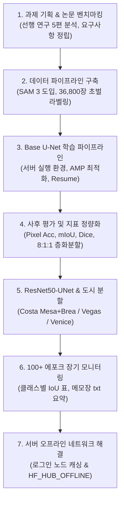

# 📋 프로젝트 종합 업무 수행 보고서 (`docs/works.md`)

**프로젝트명**: Alo Yoga 글로벌 매장 공사 현장 모니터링 및 비전 AI 기반 진척도 자동 분석 시스템  
**작성일자**: 2026년 10월 15일  
**문서 목적**: 과제 시작부터 현재까지 수행한 모든 연구, 기획, 데이터 전처리, 모델 개발, 인프라 최적화 및 평가 체계 구축 내역을 상세히 기록하고 진행 상태를 공유함.

---

## 📌 목차
1. [프로젝트 개요 및 기획 배경](#1-프로젝트-개요-및-기획-배경)
2. [전체 업무 추진 타임라인](#2-전체-업무-추진-타임라인)
3. [상세 업무 수행 내역](#3-상세-업무-수행-내역)
   - [3.1 선행 연구 조사 및 도메인 분석](#31-선행-연구-조사-및-도메인-분석)
   - [3.2 대규모 데이터셋 구축 및 SAM 3 초벌 전처리](#32-대규모-데이터셋-구축-및-sam-3-초벌-전처리)
   - [3.3 1차 U-Net 베이스라인 모델 개발 및 서버 파이프라인](#33-1차-u-net-베이스라인-모델-개발-및-서버-파이프라인)
   - [3.4 에포크별 종합 평가 체계 (`evaluate_epochs.py`) 구축](#34-에포크별-종합-평가-체계-evaluate_epochspy-구축)
   - [3.5 2차 모델 고도화: ResNet50-UNet 및 도시 폴더 분할](#35-2차-모델-고도화-resnet50-unet-및-도시-폴더-분할)
   - [3.6 100+ 에포크 장기 학습 모니터링 시스템 구축](#36-100-에포크-장기-학습-모니터링-시스템-구축)
   - [3.7 GPU 서버(Slurm 클러스터) 운영 및 오프라인 네트워크 대응](#37-gpu-서버slurm-클러스터-운영-및-오프라인-네트워크-대응)
4. [핵심 기술 산출물 목록](#4-핵심-기술-산출물-목록)
5. [업무 완료 현황 요약 (Done List)](#5-업무-완료-현황-요약-done-list)
6. [향후 추진 계획 (Next Steps)](#6-향후-추진-계획-next-steps)

---

## 1. 프로젝트 개요 및 기획 배경

* **배경**: Alo Yoga의 글로벌 오프라인 매장 급증('23년 21개소 → '26년 246개소 목표)에 따라, 기존의 '현장 직접 방문'이나 '시공사 주간 서면 보고서'에 의존하던 공정 관리 방식의 한계(비용 증가, 지연 발견 늑장 대응, 보고 왜곡)를 해결하고자 함.
* **목표**: 
  1. 순회 촬영된 현장 사진에서 주요 공종(바닥, 경량철골, 벽체, 천장, 배관 등 10개 객체)을 비전 AI로 정밀 식별.
  2. 텍스트 공정표와 대조하여 일일 진척도 변화량을 감지하고, 지연 의심 근거 사진을 포함한 데일리 브리핑 리포트를 매일 아침 자동 생성·발송하는 AI 에이전트 구축.
* **인프라 제약**: 외부 상용 API(OpenAI, Claude 등) 호출을 배제하고, 학교 GPU 서버(NVIDIA A6000 62GB 등) 및 로컬 환경에서 독자 구동 가능한 경량 오픈소스 파이프라인으로 구성.

---

## 2. 전체 업무 추진 타임라인

| 단계 | 기간 | 주요 목표 | 달성 결과 |
| :--- | :--- | :--- | :--- |
| **1단계: 기획 & 선행연구** | 1~3주차 | 문제 정의, 선행 논문 5편 분석, 시스템 5단계 흐름 수립 | 주제 확정, mAP 90% / mIoU 60% 정량 목표 설정 |
| **2단계: 데이터 전처리** | 4~5주차 | 36,800장 현장 데이터 정제 및 라벨링 자동화 | Meta SAM 3 파이프라인 개발, LabelMe JSON 생성 |
| **3단계: 베이스라인 개발** | 5~6주차 | PyTorch 기본 U-Net 모델 구축 및 무중단 서버 학습 | `train_unet_server.py`, FP16 AMP, 체크포인트 이어학습 |
| **4단계: 지표 고도화** | 6주차 | 에포크별 성능 정량화 및 층화 검증 체계 확립 | `evaluate_epochs.py`, 8:1:1 분할, mIoU/Dice 지표 도출 |
| **5단계: 모델 구조 전환** | 6주차 | 현장 간 데이터 누수 차단 및 특징 추출력 강화 | `train_res50unet_server.py` 개발, 도시 폴더 분할 체계 |
| **6단계: 모니터링 고도화** | 6주차 | 100+ 에포크 장기 학습 추이 일괄 확인 기능 | 클래스별 IoU 표, `epoch_summary.txt` (메모장 요약표) |
| **7단계: 서버 인프라 안정화** | 현재 | Slurm 연산 노드 오프라인 제약 해결 및 배포 | GPU_Server_Commands 가이드, 캐시 폴백 적용 |

---

## 3. 상세 업무 수행 내역

### 3.1 선행 연구 조사 및 도메인 분석
* **핵심 논문 5편 심층 분석 및 번역**:
  - *YOLOv8 기반 창문 설치 공정 모니터링 (PLOS One, 2025)*: QR/BIM 연동 실시간 단계 탐지(mAP 0.953).
  - *PPVC 모듈형 시공 모니터링 (Sensors, 2024)*: 가려짐(Occlusion) 규칙 보정 WAVBCPM 분석.
  - *BIM 및 합성 데이터 기반 AR 실내 모니터링 (JMSET, 2025)*: Isaac Sim 가상 데이터(MEP-SEG) 활용 전략.
  - *소규모 데이터 기반 ANN 공사 기간 예측 (Applied Sciences, 2023)*: 135건 계약 데이터 이상치 필터링.
  - *ANFIS 기반 공사비 예측 (한국건축시공학회지, 2023)*: 5개 변수 기반 투명 추정 모델.
* **비전 AI 모델 벤치마킹 (Grounding DINO vs SAM)**:
  - 초기 개방형 검출기(Grounding DINO)의 복잡한 2단계 파이프라인 대비, 텍스트 프롬프트로 한 번에 영역 마스크를 추출하는 **Meta SAM 3**의 효율성을 확인하고 전처리 엔진으로 최종 채택.
* **비전 파트 한계점 규명 및 역할 정의**:
  - 사진 1장으로 절대적 3D 공정률을 직접 산출하는 비현실적 접근을 지양하고, **비전 AI는 '설치 상태 및 변화량을 감지하여 구조화된 메타데이터(JSON)를 추출'**하고, **최종 공정률 판정은 LLM 에이전트가 텍스트 공정표와 대조**하는 역할 분담을 정립.

---

### 3.2 대규모 데이터셋 구축 및 SAM 3 초벌 전처리
* **데이터셋 규모**: 미국 내 4개 매장 현장 사진 **총 36,863장**
  - `Alo_Yoga_-_#120_-_Brea,_CA`: 10,175장
  - `Alo_Yoga_-_#127_-_Costa_Mesa,_CA`: 9,918장
  - `Alo_Yoga_-_#130_-_Las_Vegas`: 7,362장
  - `Alo_Yoga_-_#148_-_Venice`: 9,407장
* **공정 모니터링 10대 핵심 클래스 정의**:
  - `0: background` (배경)
  - `1: floor` (바닥재/타일)
  - `2: metal stud framing` (경량철골 스터드)
  - `3: wall` (석고보드/벽체)
  - `4: ceiling` (천장 마감)
  - `5: HVAC ductwork` (공조/배관 덕트)
  - `6: person` (작업자)
  - `7: construction materials` (적치 자재)
  - `8: Tools` (작업 공구)
  - `9: unidentifiable` (미식별 객체)
* **초벌 전처리 파이프라인 개발 (`process.md`)**:
  - SAM 3(Segment Anything Model 3)의 개념 분할(Promptable Concept Segmentation)을 활용하여 수만 장 사진의 인스턴스를 다각형(Polygon) 좌표로 자동 추출.
  - X-AnyLabeling / LabelMe 표준 포맷의 JSON 파일로 변환하여 수동 검수(Human-in-the-loop)가 가능한 데이터 파이프라인 완성.

---

### 3.3 1차 U-Net 베이스라인 모델 개발 및 서버 파이프라인
* **경량 시맨틱 분할 모델 구축 (`src/train_unet_server.py`)**:
  - PyTorch 기반 4단 Encoder-Bottleneck-Decoder U-Net 직접 구현 ($512 \times 512$ 입력, 10개 클래스 출력).
* **데이터 로더 결함 내구성(Fault Tolerance) 확보**:
  - **한글/유니코드 경로 호환**: Windows와 Linux 간 경로 문제 해결을 위해 `np.fromfile` + `cv2.imdecode` 기반 안전 로더(`imread_unicode`) 적용.
  - **손상 데이터 자동 스킵**: 0바이트 이미지나 디코딩 실패 시 다음 파일로 자동 우회.
  - **불완전 JSON 예외 방어**: 다운로드 도중 끊긴 불완전 JSON 파일 파싱 시 에러로 인한 학습 중단 방지.
* **서버 자원 최적화**:
  - **VRAM OOM 차단**: 배치 크기를 16으로 최적화하고, `torch.amp.autocast` (FP16 혼합 정밀도) 및 `GradScaler`를 적용하여 연산 속도 2배 향상 및 메모리 점유율 반감.
* **학습 안정성 및 시각화 기능**:
  - **체크포인트 자동 이어 학습(Resume)**: 불의의 터미널 종료나 Slurm 시간 초과에 대비해 최신 체크포인트(`.pth`)를 자동 감지하여 다음 에포크부터 연속 학습.
  - **동적 저장 스케줄러**: 20 에포크 이하는 5단위, 20 에포크 초과는 1단위로 체크포인트 및 시각자료 분기 저장.
  - **4열 예측 비교 시각화**: `[원본 | 정답 라벨 | 모델 예측 | 50% 오버레이]` 고해상도 PNG 자동 출력.

---

### 3.4 에포크별 종합 평가 체계 (`src/evaluate_epochs.py`) 구축
* **문제의식**: 저장된 에포크별 체크포인트들 중 단순 Loss 수치만으로는 "실제 영역이 얼마나 정확히 겹치는지" 객관적 비교가 어려움.
* **구현 내용**:
  - `weights/` 폴더 내 모든 에포크 가중치(`unet_epoch_*.pth`)를 일괄 스캔하여 성능 변화 추이를 정밀 계산.
  - **3대 정량 지표 산출**:
    1. **Pixel Accuracy (%)**: 전체 픽셀 중 맞춘 픽셀 비율.
    2. **mIoU (Mean Intersection over Union, %)**: 클래스별 정답과 예측의 겹침 비율.
    3. **Mean Dice Score / F1 (%)**: 경계선 민감도 및 정밀도 지표.
  - **출력 산출물**:
    - 터미널 종합 순위표 출력 및 최고 mIoU 에포크 자동 판정.
    - 클래스별 세부 겹침 스코어 테이블 도출.
    - `runs/epoch_evaluation_metrics.csv` (엑셀용 통계 파일).
    - `runs/epoch_evaluation_trends.png` (에포크별 지표 추이 그래프).

---

### 3.5 2차 모델 고도화: ResNet50-UNet 및 도시 폴더 분할
* **기존 방식의 한계 발견**:
  - 전체 데이터를 무작위 80:10:10 또는 도시별 10% 층화 분할(Stratified Split)할 경우, **동일한 현장에서 몇 분 간격으로 찍힌 연속 사진이 Train과 Val/Test에 모두 들어가 데이터 누수(Data Leakage)** 발생 위험.
  - 일반 CNN U-Net은 복잡한 건설 자재 및 조명 변화에 대한 특징 추출력 한계 존재.
* **해결책 1: 도시(현장) 폴더 단위의 완전 분리 (City-level Split)**:
  - **Train 세트 (20,093장)**: `Costa_Mesa` (9,918장) + `Brea` (10,175장)
  - **Validation 세트 (7,362장)**: `Las_Vegas` → 최고 모델(`res50unet_best.pth`) 선정 기준
  - **Test 세트 (9,407장)**: `Venice` → 학습 시 한 번도 보지 못한 완전히 새로운 현장에 대한 최종 일반화 성능 검증
  - 현장 간의 완전한 격리를 통해 **실제 현장 투입 시의 진짜 일반화 성능**을 검증할 수 있도록 데이터 체계 개편.
* **해결책 2: ResNet50 백본 + ImageNet 사전학습 가중치 도입 (`src/train_res50unet_server.py`)**:
  - `segmentation-models-pytorch` 기반 ResNet50 인코더와 U-Net 디코더 결합.
  - ImageNet 표준 정규화(`mean=[0.485, 0.456, 0.406]`, `std=[0.229, 0.224, 0.225]`) 적용.
  - 수평 반전(Horizontal Flip) 실시간 데이터 증강 적용.
  - 옵티마이저/스케일러 내부 상태까지 완벽 직렬화하는 차세대 체크포인트 구조 설계.
  - 기존 모델과의 충돌을 방지하기 위해 산출물 디렉토리를 `weights/res50_unet/`, `runs/res50_unet/`으로 독립 분리.

---

### 3.6 100+ 에포크 장기 학습 모니터링 시스템 구축
* **클래스별 세부 IoU (Class-wise IoU) 실시간 표 출력**:
  - 배경, 벽체 등 면적이 큰 클래스에 수치가 왜곡되어 작업자(person), 공구(Tools), 배관(HVAC) 등의 소형 객체가 붕괴되는 현상을 방지하기 위해, 매 에포크마다 10개 클래스 각각의 IoU를 터미널 표로 출력 및 `training_history.json`에 영구 기록.
* **메모장(Windows Notepad) 전용 자동 기록 시스템 (`.txt`)**:
  - 100에포크가 넘어가면 JSON이나 콘솔 로그로는 전체 흐름 파악이 어렵다는 문제를 해결하기 위해, UTF-8-SIG(BOM 포함) 인코딩의 2가지 텍스트 파일 자동 생성:
  1. **`epoch_summary.txt` (일괄 확인용 요약표)**:
     - 1행 1에포크 형식으로 전체 에포크의 Train/Val/Test 손실, 정확도, mIoU를 가지런히 표로 정리.
     - 파일 하단에 `[전체 기간 최고 성능 달성 에포크]`를 자동 갱신 표기하여 어떤 체크포인트를 사용해야 할지 1초 만에 확인 가능.
  2. **`epoch_details.txt` (상세 로그)**:
     - 에포크별로 10개 클래스의 겹침 점수 표를 블록 단위로 누적 기록하여 특정 에포크의 클래스별 추이를 메모장 검색(`Ctrl+F`)으로 즉시 추적 가능.

---

### 3.7 GPU 서버(Slurm 클러스터) 운영 및 오프라인 네트워크 대응
* **서버 환경**: 경북대 AI 전산실 ABR 서버 (로그인 노드: `coss32@ABRM02`, GPU 노드: `DIS06` 등, Slurm p02 파티션).
* **서버 명령어 및 운영 매뉴얼 완성**:
  - [`GPU_Server_Commands.md`](file:///c:/Users/user/OneDrive/바탕%20화면/3-2/종설프/Aloha/GPU_Server_Commands.md): SSH 접속, squeue 현황 확인, srun 대화형 할당, sbatch 백그라운드 무중단 제출, conda 환경 제어 명령어 총정리.
  - [`SERVER_RUN_GUIDE.md`](file:///c:/Users/user/OneDrive/바탕%20화면/3-2/종설프/Aloha/SERVER_RUN_GUIDE.md): 복사/붙여넣기로 즉시 실행 가능한 명령어 모음.
* **연산 노드 네트워크 격리(Air-gapped) 이슈 해결**:
  - GPU 연산 노드(`DIS06`)는 보안상 외부 인터넷(DNS)이 차단되어 HuggingFace 가중치 다운로드 시 `[Errno -3] Temporary failure in name resolution` 발생.
  - **대응 1**: 인터넷이 가능한 로그인 노드(`ABRM02`)에서 가중치를 1회 다운로드하여 공유 홈 디렉토리(`~/.cache/`)에 캐시하는 운영 절차 정립.
  - **대응 2**: `src/train_res50unet_server.py` 코드 내에 인터넷 단절 시 자동으로 `HF_HUB_OFFLINE=1`을 설정하여 캐시된 파일을 즉시 불러오는 자동 폴백 로직 구현.

---

## 4. 핵심 기술 산출물 목록

### 📁 핵심 실행 스크립트 (`src/`)
| 파일 경로 | 주요 역할 및 기능 |
| :--- | :--- |
| [`src/train_res50unet_server.py`](file:///c:/Users/user/OneDrive/바탕%20화면/3-2/종설프/Aloha/src/train_res50unet_server.py) | **[최신 주력]** ResNet50 백본 + ImageNet 사전학습 U-Net 학습 스크립트. 도시 폴더 단위 분할(Train: Costa Mesa+Brea / Val: Las Vegas / Test: Venice), 클래스별 IoU 표 출력, 메모장 txt 요약, 오프라인 HF 캐시 폴백 지원. |
| [`src/train_unet_server.py`](file:///c:/Users/user/OneDrive/바탕%20화면/3-2/종설프/Aloha/src/train_unet_server.py) | **[베이스라인]** Custom PyTorch U-Net 학습 스크립트. 결함 데이터 방어, AMP FP16 가속, 동적 체크포인트 저장, 4열 시각화 생성. |
| [`src/evaluate_epochs.py`](file:///c:/Users/user/OneDrive/바탕%20화면/3-2/종설프/Aloha/src/evaluate_epochs.py) | 저장된 전체 에포크 가중치를 순회 평가하여 Pixel Accuracy, mIoU, Dice Score 및 클래스별 통계를 도출하고 CSV/그래프로 시각화하는 평가 도구. |
| [`src/train_unet.py`](file:///c:/Users/user/OneDrive/바탕%20화면/3-2/종설프/Aloha/src/train_unet.py) | 로컬 PC(Windows/단일 GPU) 디버깅 및 소규모 테스트용 U-Net 스크립트. |

### 📄 핵심 기술 문서 (`docs/` 및 루트)
| 파일 경로 | 문서 내용 및 목적 |
| :--- | :--- |
| [`docs/works.md`](file:///c:/Users/user/OneDrive/바탕%20화면/3-2/종설프/Aloha/docs/works.md) | **[본 문서]** 프로젝트 시작부터 현재까지의 전체 업무 수행 내역, 기술적 의사결정, 산출물 및 현황 종합 보고서. |
| [`GPU_Server_Commands.md`](file:///c:/Users/user/OneDrive/바탕%20화면/3-2/종설프/Aloha/GPU_Server_Commands.md) | KNU AI GPU 서버 접속, Slurm 작업 스케줄러(`srun`, `sbatch`, `squeue`, `scancel`), Conda 환경 관리 공식 가이드. |
| [`SERVER_RUN_GUIDE.md`](file:///c:/Users/user/OneDrive/바탕%20화면/3-2/종설프/Aloha/SERVER_RUN_GUIDE.md) | 서버 접속 후 즉시 실행할 수 있는 명령어 복사/붙여넣기 퀵시트. |
| [`unet_use.md`](file:///c:/Users/user/OneDrive/바탕%20화면/3-2/종설프/Aloha/unet_use.md) | U-Net 아키텍처 구조, 하이퍼파라미터 튜닝 가이드, 7대 핵심 기능 및 출력물 설명서. |
| [`process.md`](file:///c:/Users/user/OneDrive/바탕%20화면/3-2/종설프/Aloha/process.md) | Meta SAM 3 기반 대규모 시맨틱 분할 전처리 및 X-AnyLabeling 검수 파이프라인 매뉴얼. |
| [`project_context.md`](file:///c:/Users/user/OneDrive/바탕%20화면/3-2/종설프/Aloha/project_context.md) | 과제 기획 배경, 선행 논문 5편 번역 및 핵심 분석 요약본. |

---

## 5. 업무 완료 현황 요약 (Done List)

* [x] **과제 정의 및 시스템 기획**:
  - [x] 글로벌 매장 확장 공사 모니터링 문제 정의 및 5단계 AI 파이프라인 수립
  - [x] 선행 논문 5편(YOLOv8 창문, PPVC 모듈, MEP-SEG AR, ANN 공기예측, ANFIS 공사비) 번역 및 벤치마킹
  - [x] 비전 모델 목표치 정량화 (mAP 90%, mIoU 60%)
* [x] **데이터 전처리 파이프라인 완성**:
  - [x] 4개 도시 현장 원본 사진 36,863장 정리 및 표준 파일 명명 체계 수립
  - [x] 10개 핵심 공종 클래스 매핑(바닥, 벽, 경량철골, 천장, 배관, 작업자, 자재, 공구 등)
  - [x] Meta SAM 3 텍스트 프롬프트 기반 자동 분할 및 LabelMe 호환 다각형 JSON 일괄 생성
* [x] **1차 U-Net 모델 학습 및 서버 안정화**:
  - [x] PyTorch U-Net 모델 직접 구현
  - [x] 한글 경로 호환, 깨진 이미지/JSON 자동 스킵 등 무중단 결함 방어 로직 구현
  - [x] PyTorch AMP FP16 도입으로 VRAM OOM 방지 및 배치 16 최적화
  - [x] 체크포인트 자동 이어 학습(Resume) 기능 구현
  - [x] 4열 시각화(원본/정답/예측/오버레이) 및 실시간 학습 곡선 그래프 생성
* [x] **평가 및 사후 분석 체계 구축**:
  - [x] 에포크별 일괄 평가 스크립트(`evaluate_epochs.py`) 개발 (Pixel Acc, mIoU, Dice Score)
  - [x] 평가 결과 CSV 내보내기 및 트렌드 그래프 자동 생성
* [x] **2차 모델 고도화 (ResNet50-UNet & City-level Split)**:
  - [x] 현장 간 데이터 누수(Data Leakage) 차단을 위한 도시 폴더 단위 분할 체계 적용
    - Train: `Costa_Mesa` (9,918장) + `Brea` (10,175장) = 20,093장
    - Val: `Las_Vegas` (7,362장)
    - Test: `Venice` (9,407장)
  - [x] `segmentation-models-pytorch` 기반 ResNet50-UNet (ImageNet 사전학습) 파이프라인 개발
  - [x] ImageNet 정규화 및 데이터 증강(좌우 반전) 적용
  - [x] 옵티마이저/스케일러 통합 직렬화 차세대 체크포인트 저장 구조 구현
* [x] **모니터링 및 로깅 시스템 고도화**:
  - [x] 매 에포크 종료 시 10개 클래스별 세부 IoU(겹침 점수) 터미널 표 출력
  - [x] `training_history.json`에 클래스별 IoU 시계열 데이터 영구 누적
  - [x] 100+ 에포크 장기 학습 일괄 확인용 `epoch_summary.txt` (메모장 표) 자동 갱신 기능 구현
  - [x] 클래스별 세부 내역 누적용 `epoch_details.txt` 자동 기록 기능 구현
* [x] **GPU 서버(Slurm) 운영 인프라 안정화**:
  - [x] Slurm 배치/인터랙티브 실행 및 모니터링 가이드 작성
  - [x] GPU 연산 노드 오프라인 네트워크 환경 대응 (`HF_HUB_OFFLINE` 폴백 로직 구현)

---

## 6. 향후 추진 계획 (Next Steps)

1. **ResNet50-UNet 서버 대규모 학습 완주 및 수렴 확인**:
   - 로그인 서버에서 ImageNet 가중치 캐싱 후 GPU 노드(`DIS06`)에서 50~100 에포크 본격 학습 실행.
   - `epoch_summary.txt`를 통해 Las Vegas(검증셋) 및 Venice(테스트셋)의 mIoU 수렴 추이 모니터링.
2. **Base U-Net vs ResNet50-UNet 일반화 성능 비교 분석**:
   - 단순 CNN U-Net 대비 ResNet50 백본 모델이 처음 보는 매장(Venice 현장)에서 달성하는 mIoU 격차 정량 분석.
   - 클래스별 세부 지표 분석을 통해 경량철골, 덕트 배관, 공구 등 난이도 높은 클래스의 검출력 개선도 검증.
3. **희소/소형 클래스 탐지력 강화를 위한 손실 함수 개선**:
   - 배경/바닥/벽체 편향을 완화하기 위해 Cross-Entropy 외에 **Focal Loss** 또는 **Dice Loss** 결합 손실 함수 도입 검토.
4. **후속 파이프라인 연계 (LLM 기반 진척도 자동 보고 에이전트)**:
   - 비전 모델이 추론한 에포크별/일자별 마스크 및 자재 카운팅 결과를 구조화된 JSON 메타데이터로 변환.
   - 로컬 경량 LLM(Ollama - Llama 3 / Gemma 2 등)과 연계하여 시공 텍스트 공정표와 대조하고 지연 사유 브리핑 리포트를 자동 생성하는 에이전트 모듈 개발 착수.
